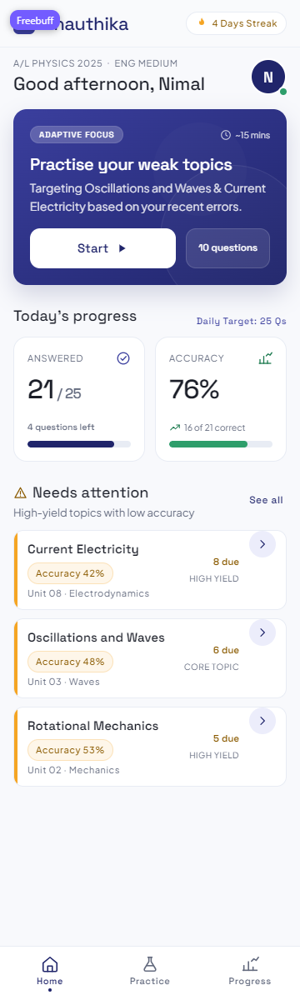

# Bhauthika

Adaptive G.C.E. A/L Physics practice for Sri Lankan English-medium students: past-paper MCQs with worked derivations and per-topic mastery tracking.

**Live demo:** https://bhauthika.vercel.app *(placeholder)*



## Stack

Next.js · TypeScript · Tailwind · Supabase (planned) · Vercel

## Getting started

```bash
git clone https://github.com/DissanayakeLYB/Bhauthika.git
cd Bhauthika
npm install
npm run dev        # http://localhost:3000
```

## Project structure

```
src/app         routes only
src/components  small shared UI components
src/lib         question bank, session engine, storage
public          icons, PWA manifest
docs/design     original Stitch design references
```

## Roadmap

- Supabase auth and a synced progress database
- A real past-paper question bank
- Adaptive recommendations built on answer history

## License

MIT — see [LICENSE](LICENSE).
